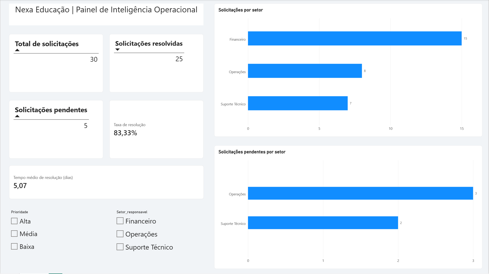

# Nexa Educação | Painel de Inteligência Operacional

## Sobre o projeto

Projeto de análise de dados operacionais desenvolvido para aplicar conhecimentos de Python, Ciência de Dados e Business Intelligence na avaliação de solicitações e no acompanhamento de indicadores de desempenho.

O objetivo é transformar registros operacionais em informações que auxiliem a identificação de pendências, a análise de prioridades e a tomada de decisões gerenciais.

## Tecnologias utilizadas

- **Python:** tratamento, exploração e análise dos dados.
- **Pandas:** manipulação de dados e cálculo de indicadores.
- **Jupyter Notebook:** desenvolvimento e documentação da análise.
- **Power BI:** construção do dashboard interativo.
- **Excel:** armazenamento da base de dados utilizada.

## Indicadores analisados

- Total de solicitações registradas.
- Quantidade de solicitações resolvidas e pendentes.
- Taxa de resolução.
- Tempo médio de resolução.
- Distribuição de solicitações por setor responsável.
- Distribuição por prioridade.

A análise de uma base fictícia de 30 solicitações apresentou:

| Indicador | Resultado |
|---|---|
| Total de solicitações | 30 |
| Solicitações resolvidas | 25 |
| Solicitações pendentes | 5 |
| Taxa de resolução | 83,33% |
| Tempo médio de resolução | 5,07 dias |

Os resultados foram organizados em um dashboard no Power BI, com filtros para exploração dos indicadores por setor e prioridade.

## Resultados

Visualização do dashboard

## Finalidade

Este projeto integra meu portfólio de estudos em Ciência de Dados e Business Intelligence, com foco na aplicação de ferramentas analíticas à gestão de processos e à inteligência operacional.

**Observação:** todos os dados utilizados são fictícios e foram empregados exclusivamente para fins educacionais e de demonstração.
